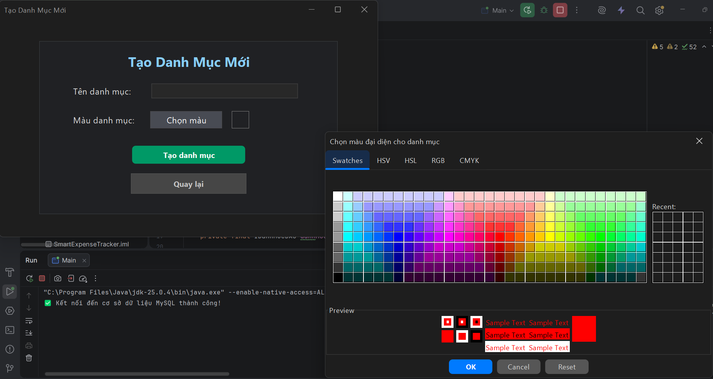
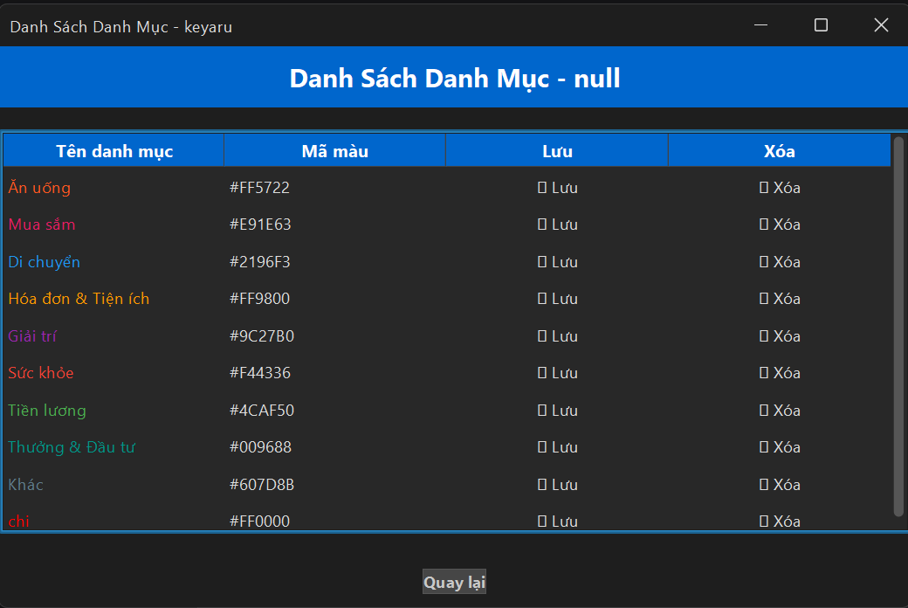

# 💸 Smart Expense Tracker - Ứng Dụng Quản Lý Chi Tiêu Thông Minh

[](https://www.java.com/)
[](https://www.mysql.com/)
[](https://www.formdev.com/flatlaf/)
[](http://www.jfree.org/jfreechart/)
[](LICENSE)

**Smart Expense Tracker** là ứng dụng máy tính (Desktop Application) được phát triển bằng **Java Swing** hiện đại kết hợp với cơ sở dữ liệu **MySQL**. Ứng dụng giúp người dùng ghi chép, theo dõi, phân loại và phân tích các khoản thu chi cá nhân một cách nhanh chóng, trực quan và khoa học.

Đặc biệt, ứng dụng đã được tối ưu hóa toàn diện cho người dùng Việt Nam: giao diện tiếng Việt hoàn chỉnh, hỗ trợ định dạng tiền tệ VNĐ với tính năng gõ tắt thông minh (50k, 5tr, 1ty), tự động tạo danh mục chuẩn, cùng hệ thống chuyển đổi giao diện linh hoạt (Giao diện Tối, Giao diện Sáng, IntelliJ).

---

## 📷 Hình Ảnh Minh Họa Giao Diện

| Đăng Nhập | Đăng Ký Tài Khoản |
| :---: | :---: |
| <br>_Màn hình đăng nhập người dùng_ | <br>_Biểu mẫu tạo tài khoản người dùng mới_ |

| Trang Chủ (Dashboard) | Thêm Khoản Thu / Chi |
| :---: | :---: |
| <br>_Bảng điều khiển chính, cho phép chuyển đổi Theme và điều hướng nhanh_ | <br>_Giao diện thêm giao dịch với nút bấm tiền tệ nhanh và xem trước_ |

| Lịch Sử Giao Dịch | Thống Kê & Phân Tích Biểu Đồ |
| :---: | :---: |
| <br>_Quản lý, tìm kiếm, lọc và cảnh báo số dư tối thiểu_ | <br>_Biểu đồ cột so sánh thu - chi theo 12 tháng, hỗ trợ lọc theo năm_ |

| Tạo Danh Mục Mới | Quản Lý Danh Mục |
| :---: | :---: |
| <br>_Thêm danh mục kèm bảng chọn mã màu tùy chỉnh_ | <br>_Xem danh sách, chỉnh sửa màu sắc và xóa danh mục dễ dàng_ |

---

## ✨ Tính Năng Nổi Bật

### 🔐 1. Xác thực & Phân quyền người dùng
- Đăng ký và đăng nhập bảo mật với tài khoản cá nhân.
- Dữ liệu chi tiêu và danh mục được cô lập riêng biệt theo từng tài khoản.

### ⚡ 2. Nhập liệu tiền tệ thông minh (Smart Input)
- **Gõ tắt nhanh chóng**: Hỗ trợ nhận diện các ký hiệu phổ biến tại Việt Nam như `50k`, `500k`, `2.5tr`, `5m`, `1ty` mà không cần gõ nhiều số `0`.
- **Hàng phím bấm số tiền nhanh**: Tích hợp các nút tiện ích `+000`, `+50k`, `+100k`, `+500k`, `+1tr`, `+5tr`, `Xóa` giúp nhập liệu tức thì chỉ với một cú nhấp chuột.
- **Xem trước quy đổi trực quan**: Tự động chuyển đổi và hiển thị định dạng số tiền chuẩn tiếng Việt ngay khi người dùng nhập liệu (ví dụ: `5.000.000 VNĐ`).

### 🏷️ 3. Quản lý danh mục linh hoạt
- **Tự động khởi tạo danh mục mẫu**: Tự động cấp sẵn 9 danh mục thiết yếu kèm màu sắc bắt mắt ngay khi tạo tài khoản mới: *Ăn uống, Mua sắm, Di chuyển, Hóa đơn & Tiện ích, Giải trí, Sức khỏe, Tiền lương, Thưởng & Đầu tư, Khác*.
- **Tùy biến không giới hạn**: Dễ dàng tạo thêm danh mục mới, chọn màu đại diện bằng bảng màu trực quan (Color Chooser).
- **Chỉnh sửa trực tiếp**: Chỉnh sửa tên, mã màu hoặc xóa danh mục ngay trên giao diện bảng danh sách.

### 📋 4. Quản lý lịch sử giao dịch toàn diện
- Hiển thị danh sách giao dịch với màu sắc tương ứng theo danh mục và loại thu/chi.
- Hộp tổng kết tài chính tức thời: **Tổng Thu Nhập**, **Tổng Chi Tiêu**, **Số Dư Hiện Tại**.
- **Cảnh báo số dư an toàn**: Tự động phát hiện và cảnh báo khi số dư xuống dưới ngưỡng tối thiểu.
- Bộ lọc và tìm kiếm giao dịch đa năng theo từ khóa (mô tả, danh mục) và loại giao dịch (Tất cả / Thu nhập / Chi tiêu).
- Hỗ trợ chỉnh sửa và xóa giao dịch trực tiếp.

### 📊 5. Biểu đồ thống kê trực quan (JFreeChart)
- Biểu đồ cột đôi so sánh trực quan giữa **Thu nhập** (Cột xanh) và **Chi tiêu** (Cột đỏ) qua 12 tháng trong năm.
- Hỗ trợ lọc thống kê theo từng năm cụ thể hoặc tổng quan tất cả các năm.

### 🎨 6. Giao diện FlatLaf hiện đại & Đa giao diện (Theme)
- Hỗ trợ 3 phong cách giao diện:
  - **Giao diện Tối (FlatMacDarkLaf)** - Hiện đại, dịu mắt (Mặc định).
  - **Giao diện Sáng (FlatMacLightLaf)** - Tinh tế, rõ ràng.
  - **Giao diện IntelliJ (FlatIntelliJLaf)** - Chuyên nghiệp theo phong cách IDE.
- Bố cục responsive căn giữa tự động khi phóng to cửa sổ, phông chữ **Segoe UI** hiển thị chuẩn tiếng Việt Unicode không bị lỗi dấu.

---

## 🛠️ Công Nghệ & Thư Viện Sử Dụng

| Thành Phần | Công Nghệ / Thư Viện | Phiên Bản | Ghi Chú |
| :--- | :--- | :--- | :--- |
| **Ngôn ngữ** | Java (JDK) | 17+ | Ngôn ngữ lập trình chính |
| **Giao diện** | Java Swing / AWT | Tích hợp sẵn | Xây dựng các cửa sổ và thành phần UI |
| **Theme UI** | FlatLaf | 3.6 | Look and Feel giao diện phẳng hiện đại |
| **Cơ sở dữ liệu** | MySQL Server | 8.x | Lưu trữ dữ liệu người dùng và giao dịch |
| **Kết nối CSDL** | MySQL Connector/J | 9.3.0 | Driver JDBC kết nối ứng dụng với MySQL |
| **Vẽ biểu đồ** | JFreeChart | 1.5.3 | Thư viện biểu đồ thống kê chuyên nghiệp |
| **Thư viện phụ trợ** | JCommon | 1.0.24 | Hỗ trợ xử lý hiển thị cho JFreeChart |

---

## 🗄️ Cấu Trúc Cơ Sở Dữ Liệu (Database Schema)

Tạo cơ sở dữ liệu và các bảng cần thiết trên MySQL bằng đoạn mã SQL dưới đây:

```sql
-- 1. Tạo cơ sở dữ liệu với bảng mã UTF-8 hỗ trợ tiếng Việt
CREATE DATABASE IF NOT EXISTS expense_tracker 
CHARACTER SET utf8mb4 
COLLATE utf8mb4_unicode_ci;

USE expense_tracker;

-- 2. Bảng lưu trữ thông tin người dùng (users)
CREATE TABLE IF NOT EXISTS users (
    id INT AUTO_INCREMENT PRIMARY KEY,
    username VARCHAR(50) NOT NULL UNIQUE,
    email VARCHAR(100),
    password VARCHAR(100) NOT NULL
) ENGINE=InnoDB DEFAULT CHARSET=utf8mb4 COLLATE=utf8mb4_unicode_ci;

-- 3. Bảng lưu trữ danh mục thu/chi (categories)
CREATE TABLE IF NOT EXISTS categories (
    id INT AUTO_INCREMENT PRIMARY KEY,
    user_id INT NOT NULL,
    name VARCHAR(50) NOT NULL,
    color VARCHAR(7) NOT NULL,
    FOREIGN KEY (user_id) REFERENCES users(id) ON DELETE CASCADE
) ENGINE=InnoDB DEFAULT CHARSET=utf8mb4 COLLATE=utf8mb4_unicode_ci;

-- 4. Bảng lưu trữ chi tiết các giao dịch (transactions)
CREATE TABLE IF NOT EXISTS transactions (
    id INT AUTO_INCREMENT PRIMARY KEY,
    username VARCHAR(50) NOT NULL,
    category_name VARCHAR(50) NOT NULL,
    description VARCHAR(255),
    amount DECIMAL(15,2) NOT NULL,
    date TIMESTAMP DEFAULT CURRENT_TIMESTAMP,
    type ENUM('income', 'expense') NOT NULL DEFAULT 'expense'
) ENGINE=InnoDB DEFAULT CHARSET=utf8mb4 COLLATE=utf8mb4_unicode_ci;
```

---

## 🚀 Hướng Dẫn Cài Đặt & Chạy Ứng Dụng

### Bước 1: Sao chép mã nguồn (Clone repository)
```bash
git clone https://github.com/thisisAtharv/ExpenseTracker.git
cd ExpenseTracker
```

### Bước 2: Thiết lập Cơ sở dữ liệu MySQL
1. Mở công cụ quản trị MySQL của bạn (MySQL Workbench, phpMyAdmin, DBeaver hoặc MySQL CLI).
2. Chạy toàn bộ mã lệnh trong phần [Cấu Trúc Cơ Sở Dữ Liệu](#-cấu-trúc-cơ-sở-dữ-liệu-database-schema) ở trên.

### Bước 3: Cấu hình thông tin kết nối Cơ sở dữ liệu
Mở file `src/db/DBConnection.java` và chỉnh sửa tài khoản (`USER`) và mật khẩu (`PASSWORD`) MySQL phù hợp với máy tính của bạn:

```java
package db;

import java.sql.Connection;
import java.sql.DriverManager;
import java.sql.SQLException;

public class DBConnection {
    // Đảm bảo có tham số mã hóa UTF-8 để lưu và hiển thị tiếng Việt chính xác
    private static final String URL = "jdbc:mysql://localhost:3306/expense_tracker?useUnicode=true&characterEncoding=UTF-8&serverTimezone=UTC";
    private static final String USER = "root";              // Thay bằng tên đăng nhập MySQL của bạn
    private static final String PASSWORD = "your_password"; // Thay bằng mật khẩu MySQL của bạn

    public static Connection getConnection() throws SQLException {
        return DriverManager.getConnection(URL, USER, PASSWORD);
    }
}
```

### Bước 4: Chạy dự án bằng IntelliJ IDEA hoặc Eclipse
1. Mở thư mục dự án bằng **IntelliJ IDEA** (hoặc IDE Java bạn yêu thích).
2. Thêm các thư viện JAR trong thư mục `Drivers/` vào dự án:
   - Vào `File` -> `Project Structure` -> `Libraries` -> Nhấn dấu `+` chọn `Java`.
   - Chọn các file JAR:
     - `Drivers/flatlaf-3.6.jar`
     - `Drivers/jfreechart-1.5.3.jar`
     - `Drivers/jcommon-1.0.24.jar`
     - `Drivers/mysql-connector-j-9.3.0/mysql-connector-j-9.3.0.jar`
   - Nhấn `Apply` và `OK`.
3. Tìm file `src/Main.java`, nhấn chuột phải và chọn **Run 'Main.main()'** để khởi chạy ứng dụng.

---

## 📂 Cấu Trúc Thư Mục Dự Án

```
ExpenseTracker-main/
│
├── assets/                          # Hình ảnh chụp giao diện minh họa cho tài liệu
│   ├── login.png                    # Giao diện Đăng nhập
│   ├── register.png                 # Giao diện Đăng ký
│   ├── homepage.png                 # Giao diện Trang chủ
│   ├── addexpense.png               # Giao diện Thêm khoản thu/chi
│   ├── transactions.png             # Giao diện Lịch sử giao dịch
│   ├── Analytics.png                # Giao diện Biểu đồ thống kê
│   ├── createcategory.png           # Giao diện Tạo danh mục mới
│   └── managecategory.png           # Giao diện Quản lý danh mục
│
├── Drivers/                         # Các thư viện bổ trợ (JARs)
│   ├── flatlaf-3.6.jar              # Thư viện giao diện FlatLaf
│   ├── jfreechart-1.5.3.jar         # Thư viện vẽ biểu đồ phân tích
│   ├── jcommon-1.0.24.jar           # Thư viện hỗ trợ hiển thị biểu đồ
│   └── mysql-connector-j-9.3.0/     # Driver kết nối cơ sở dữ liệu MySQL
│
├── src/                             # Mã nguồn chính của ứng dụng
│   ├── Main.java                    # Lớp khởi động chính của chương trình
│   │
│   ├── db/                          # Gói quản lý kết nối cơ sở dữ liệu
│   │   └── DBConnection.java        # Quản trị kết nối JDBC tới MySQL
│   │
│   └── model/                       # Gói chứa các màn hình và tiện ích hỗ trợ
│       ├── AddExpense.java          # Màn hình ghi chép khoản thu/chi
│       ├── Analytics.java           # Màn hình thống kê biểu đồ theo tháng/năm
│       ├── Category.java            # Lớp đối tượng biểu diễn danh mục
│       ├── CreateCategory.java      # Màn hình tạo danh mục mới và chọn màu
│       ├── DanhMucHelper.java       # Tiện ích khởi tạo danh mục mặc định cho user
│       ├── DinhDangTienHelper.java  # Tiện ích quy đổi gõ tắt và định dạng tiền tệ VNĐ
│       ├── GiaoDienHelper.java      # Tiện ích quản lý và đồng bộ Theme giao diện
│       ├── Home.java                # Màn hình Trang chủ (Dashboard)
│       ├── LoginPage.java           # Màn hình Đăng nhập tài khoản
│       ├── RegisterPage.java        # Màn hình Đăng ký tài khoản
│       ├── ViewCategory.java        # Màn hình Xem, sửa, xóa danh mục
│       └── ViewExpense.java         # Màn hình Lịch sử giao dịch và tìm kiếm
│
├── SmartExpenseTracker.iml          # Tệp cấu hình module của IntelliJ IDEA
└── README.md                        # Tài liệu hướng dẫn sử dụng tiếng Việt
```

---

## 💡 Hướng Dẫn Sử Dụng Nhanh

1. **Khởi chạy ứng dụng**: Khi mở ứng dụng, màn hình đăng nhập sẽ xuất hiện. Nếu chưa có tài khoản, hãy nhấp vào `"Chưa có tài khoản? Đăng ký ngay"` để tạo tài khoản mới.
2. **Khởi tạo danh mục**: Khi đăng ký thành công và đăng nhập lần đầu, hệ thống sẽ tự động tạo sẵn 9 danh mục chuẩn mực (Ăn uống, Mua sắm, Tiền lương,...).
3. **Đổi giao diện (Theme)**: Tại góc trên màn hình Trang chủ, bạn có thể dễ dàng chọn giữa `Giao diện Tối`, `Giao diện Sáng` hoặc `Giao diện IntelliJ` tùy ý. Toàn bộ các màn hình sẽ tự động đồng bộ.
4. **Nhập khoản thu / chi**:
   - Chọn loại giao dịch: `Chi tiêu` hoặc `Thu nhập`.
   - Chọn danh mục tương ứng.
   - Nhập số tiền: có thể gõ tắt nhanh như `100k`, `2.5tr` hoặc bấm trực tiếp các nút chọn nhanh `+50k`, `+100k`, `+1tr`...
   - Nhập mô tả giao dịch và bấm **"Lưu giao dịch"**.
5. **Theo dõi và thống kê**:
   - Chọn **"Xem lịch sử giao dịch"** để theo dõi số dư tổng, tìm kiếm hoặc chỉnh sửa/xóa giao dịch.
   - Chọn **"Thống kê & Phân tích"** để theo dõi biểu đồ cột biến động thu chi qua từng tháng.

---

## 📝 Giấy Phép (License)

Dự án này được phân phối dưới giấy phép **MIT License**. Bạn có thể tự do sử dụng, chỉnh sửa và phát triển cho mục đích học tập hoặc thương mại.

---

## 👏 Lời Cảm Ơn (Acknowledgements)

- [Tài liệu chính thức Java Swing - Oracle](https://docs.oracle.com/javase/8/docs/api/javax/swing/package-summary.html)
- [Thư viện giao diện FlatLaf - FormDev](https://www.formdev.com/flatlaf/)
- [Thư viện biểu đồ JFreeChart](http://www.jfree.org/jfreechart/)
