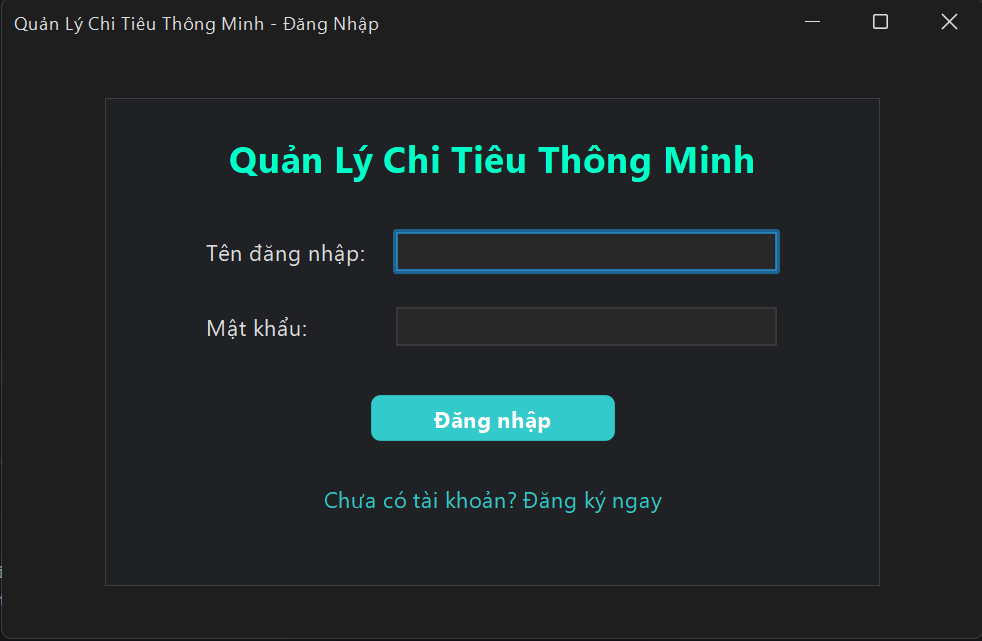
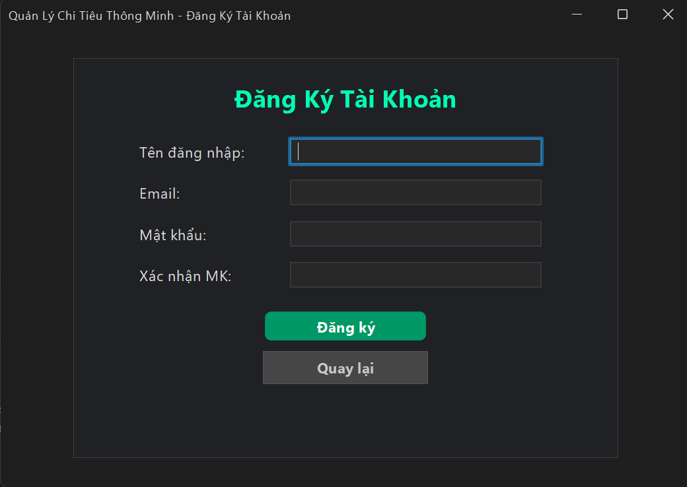
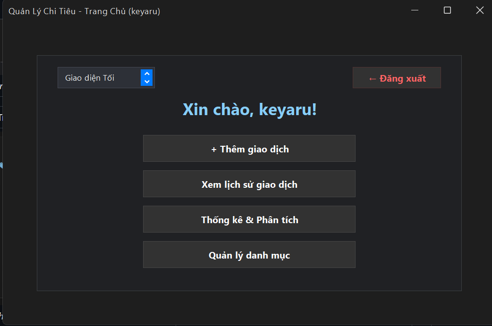
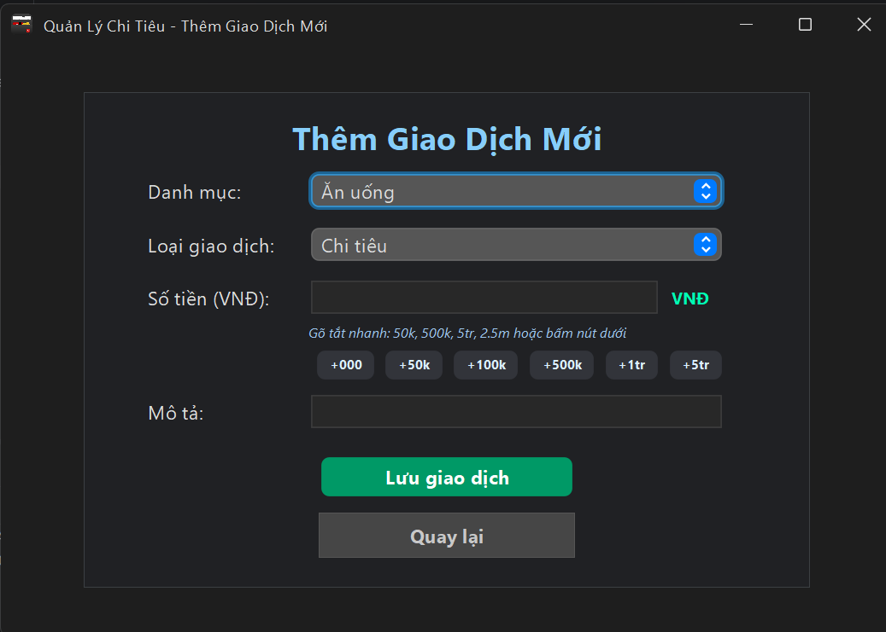
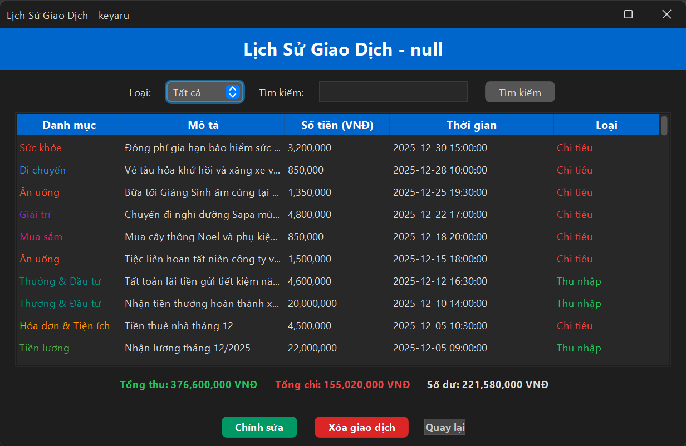
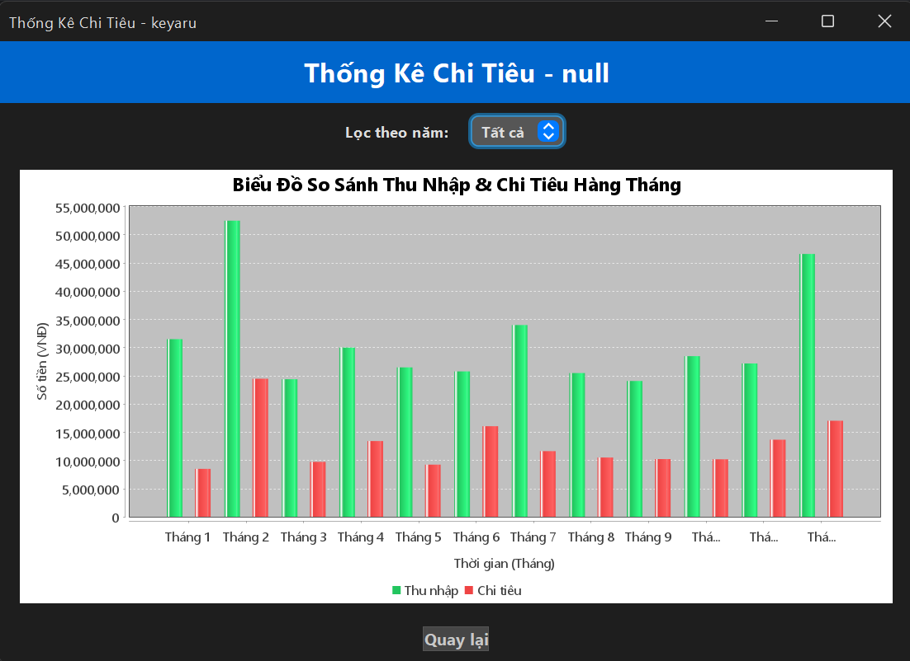

# 💸 Smart Expense Tracker - Ứng Dụng Quản Lý Chi Tiêu Thông Minh

[](https://www.java.com/)
[](https://www.mysql.com/)
[](https://www.formdev.com/flatlaf/)
[](http://www.jfree.org/jfreechart/)
[](LICENSE)

**Smart Expense Tracker** là ứng dụng máy tính (Desktop Application) được phát triển bằng **Java Swing** hiện đại kết hợp với cơ sở dữ liệu **MySQL**. Ứng dụng giúp người dùng ghi chép, theo dõi, phân loại và phân tích các khoản thu chi cá nhân một cách nhanh chóng, trực quan và khoa học.

Đặc biệt, hệ thống đã được nâng cấp toàn diện các tính năng chuẩn doanh nghiệp: **Phân quyền Quản trị viên (Admin Panel)**, **Quản lý Đa ví tiền & Chuyển tiền nội bộ (Multi-Wallet)**, **Xuất báo cáo tài chính đa kỳ (Ngày/Tháng/Quý/Năm) ra Excel và HTML in PDF**, cùng hệ thống giao diện tiếng Việt và chuyển đổi theme FlatLaf linh hoạt.

---

## 📷 Hình Ảnh Minh Họa Giao Diện

| Đăng Nhập | Đăng Ký Tài Khoản |
| :---: | :---: |
| <br>_Màn hình đăng nhập hỗ trợ phân quyền Admin/User_ | <br>_Biểu mẫu tạo tài khoản người dùng mới (tự cấp danh mục & ví)_ |

| Trang Chủ (Dashboard 2 Cột) | Thêm Khoản Thu / Chi |
| :---: | :---: |
| <br>_Bảng điều khiển chính, điều hướng Đa ví, Báo cáo và Theme_ | <br>_Giao diện thêm giao dịch với chọn Ví nguồn và nút bấm số tiền nhanh_ |

| Lịch Sử Giao Dịch | Thống Kê & Phân Tích Biểu Đồ |
| :---: | :---: |
| <br>_Hiển thị ví thanh toán, tìm kiếm, lọc và cảnh báo số dư an toàn_ | <br>_Biểu đồ cột so sánh thu - chi theo 12 tháng, hỗ trợ lọc theo năm_ |

---

## ✨ Các Tính Năng Nổi Bật

### 👑 1. Phân quyền Quản trị viên (Admin Panel)
- **Hệ thống phân quyền Role-based**: Phân tách rõ ràng giữa tài khoản người dùng (`USER`) và Quản trị viên (`ADMIN`).
- **Tài khoản Admin mặc định**: `username: admin` | `password: admin123`.
- **Thẻ thống kê hệ thống (KPI Cards)**: Xem tổng số lượng thành viên, tổng số giao dịch và tổng dòng tiền luân chuyển trên toàn hệ thống.
- **Quản lý người dùng toàn diện**:
  - Xem danh sách thành viên chi tiết.
  - **Khóa / Mở khóa tài khoản**: Chặn tức thì các tài khoản vi phạm không cho đăng nhập.
  - **Đặt lại mật khẩu**: Hỗ trợ cấp lại mật khẩu cho thành viên.
  - Xóa tài khoản người dùng kèm theo dữ liệu liên quan.

### 💳 2. Quản lý Đa ví tiền & Nguồn tiền (Multi-Wallet)
- **Tự động cấp ví**: Mỗi tài khoản đăng ký mới tự động được cấp sẵn 2 ví: *Ví Tiền mặt* và *Tài khoản Ngân hàng*.
- **Tùy biến nguồn tiền**: Thêm không giới hạn các ví như *Ví MoMo, Ví ZaloPay, Sổ Tiết kiệm, Thẻ tín dụng*.
- **Theo dõi Tổng tài sản**: Tự động tính toán tổng số dư của tất cả các ví theo thời gian thực.
- **Chuyển tiền giữa các ví (Fund Transfer)**: Chuyển tiền từ ví này sang ví khác (Ví dụ: Rút từ Ngân hàng sang Tiền mặt) với cơ chế bảo vệ giao dịch (Database Transaction ACID Rollback).
- **Liên kết giao dịch**: Khi thêm khoản thu/chi, số dư của ví được chọn sẽ tự động được cộng hoặc trừ tương ứng. Khi xóa giao dịch, hệ thống tự động hoàn tiền vào ví.

### 📑 3. Xuất Báo Cáo Tài Chính Đa Kỳ (Ngày / Tháng / Quý / Năm)
- **Lựa chọn kỳ báo cáo đa năng**:
  - **Theo Ngày**: Xem báo cáo chi tiết một ngày bất kỳ.
  - **Theo Tháng**: Báo cáo thu chi theo từng tháng trong năm.
  - **Theo Quý**: Báo cáo theo Quý 1, Quý 2, Quý 3, Quý 4.
  - **Theo Cả Năm**: Báo cáo tổng thể tình hình tài chính trong năm.
- **Nội dung báo cáo chuẩn mực**:
  - Tổng Thu, Tổng Chi, Tiết Kiệm Ròng / Thặng Dư, Tỷ lệ tiết kiệm (%).
  - Bảng cơ cấu chi tiêu theo danh mục kèm tỷ trọng (%).
  - Bảng kê chi tiết toàn bộ các giao dịch phát sinh trong kỳ.
- **Hai định dạng xuất file chuyên nghiệp**:
  - **Xuất File Microsoft Excel (.csv)**: Nhúng mã Unicode UTF-8 BOM (`\uFEFF`) giúp mở trực tiếp trên Excel mà **hoàn toàn không bị lỗi font tiếng Việt**.
  - **Xuất Báo Cáo HTML / In PDF**: Bản in định dạng HTML5 responsive cực đẹp, có nút bấm in hoặc lưu ra file PDF chuẩn chỉ với một cú nhấp chuột.

### ⚡ 4. Nhập liệu tiền tệ thông minh (Smart Input)
- **Gõ tắt nhanh chóng**: Nhận diện tức thì `50k`, `500k`, `2.5tr`, `5m`, `1ty` mà không cần gõ nhiều số `0`.
- **Hàng phím bấm số tiền nhanh**: Tích hợp các nút tiện ích `+000`, `+50k`, `+100k`, `+500k`, `+1tr`, `+5tr`, `Xóa`.
- **Xem trước quy đổi trực quan**: Hiển thị định dạng tiền chuẩn tiếng Việt ngay khi gõ.

### 🏷️ 5. Quản lý danh mục linh hoạt
- **Tự động khởi tạo 9 danh mục thiết yếu**: Ăn uống, Mua sắm, Di chuyển, Hóa đơn & Tiện ích, Giải trí, Sức khỏe, Tiền lương, Thưởng & Đầu tư, Khác.
- Tùy biến màu sắc đại diện với bảng màu (Color Chooser).

### 📋 6. Lịch sử giao dịch & Cảnh báo an toàn
- Hiển thị danh sách giao dịch với màu sắc tương ứng theo danh mục, ví tiền và loại thu/chi.
- Hộp tổng kết tài chính: Tổng Thu, Tổng Chi, Số Dư.
- **Cảnh báo bội chi / số dư an toàn**: Báo động khi số dư dưới mức tối thiểu.

### 📊 7. Biểu đồ thống kê trực quan (JFreeChart)
- Biểu đồ cột đôi so sánh trực quan giữa **Thu nhập** (Cột xanh) và **Chi tiêu** (Cột đỏ) qua 12 tháng.

### 🎨 8. Đa giao diện FlatLaf (Theme)
- Hỗ trợ 3 phong cách giao diện: **Giao diện Tối (FlatMacDarkLaf)**, **Giao diện Sáng (FlatMacLightLaf)**, và **Giao diện IntelliJ (FlatIntelliJLaf)**.

---

## 🛠️ Công Nghệ & Thư Viện Sử Dụng

| Thành Phần | Công Nghệ / Thư Viện | Phiên Bản | Ghi Chú |
| :--- | :--- | :--- | :--- |
| **Ngôn ngữ** | Java (JDK) | 17+ | Ngôn ngữ lập trình chính |
| **Giao diện** | Java Swing / AWT | Tích hợp sẵn | Xây dựng các cửa sổ và thành phần UI |
| **Theme UI** | FlatLaf | 3.6 | Look and Feel giao diện phẳng hiện đại |
| **Cơ sở dữ liệu** | MySQL Server | 8.x | Lưu trữ dữ liệu người dùng, ví và giao dịch |
| **Kết nối CSDL** | MySQL Connector/J | 9.3.0 | Driver JDBC kết nối ứng dụng với MySQL |
| **Vẽ biểu đồ** | JFreeChart | 1.5.3 | Thư viện biểu đồ thống kê chuyên nghiệp |
| **Thư viện phụ trợ** | JCommon | 1.0.24 | Hỗ trợ xử lý hiển thị cho JFreeChart |

---

## 🗄️ Cấu Trúc Cơ Sở Dữ Liệu (Database Schema)

Ứng dụng có cơ chế **Auto-Migration tự động kiểm tra và nâng cấp CSDL** khi khởi chạy. Bạn cũng có thể chủ động tạo CSDL trên MySQL bằng đoạn mã sau:

```sql
-- 1. Tạo cơ sở dữ liệu với bảng mã UTF-8 hỗ trợ tiếng Việt
CREATE DATABASE IF NOT EXISTS expense_tracker 
CHARACTER SET utf8mb4 
COLLATE utf8mb4_unicode_ci;

USE expense_tracker;

-- 2. Bảng lưu trữ thông tin người dùng (users)
CREATE TABLE IF NOT EXISTS users (
    id INT AUTO_INCREMENT PRIMARY KEY,
    username VARCHAR(50) NOT NULL UNIQUE,
    email VARCHAR(100),
    password VARCHAR(100) NOT NULL,
    vai_tro VARCHAR(20) NOT NULL DEFAULT 'USER',
    trang_thai VARCHAR(20) NOT NULL DEFAULT 'ACTIVE'
) ENGINE=InnoDB DEFAULT CHARSET=utf8mb4 COLLATE=utf8mb4_unicode_ci;

-- Tạo tài khoản Admin mặc định (mật khẩu: admin123)
INSERT INTO users (username, email, password, vai_tro, trang_thai) 
VALUES ('admin', 'admin@expensetracker.vn', 'admin123', 'ADMIN', 'ACTIVE')
ON DUPLICATE KEY UPDATE vai_tro = 'ADMIN', trang_thai = 'ACTIVE';

-- 3. Bảng lưu trữ danh mục thu/chi (categories)
CREATE TABLE IF NOT EXISTS categories (
    id INT AUTO_INCREMENT PRIMARY KEY,
    user_id INT NOT NULL,
    name VARCHAR(50) NOT NULL,
    color VARCHAR(7) NOT NULL,
    FOREIGN KEY (user_id) REFERENCES users(id) ON DELETE CASCADE
) ENGINE=InnoDB DEFAULT CHARSET=utf8mb4 COLLATE=utf8mb4_unicode_ci;

-- 4. Bảng lưu trữ danh sách Đa ví tiền (vi_tien)
CREATE TABLE IF NOT EXISTS vi_tien (
    id INT AUTO_INCREMENT PRIMARY KEY,
    user_id INT NOT NULL,
    ten_vi VARCHAR(100) NOT NULL,
    loai_vi VARCHAR(50) NOT NULL DEFAULT 'TIEN_MAT',
    so_du DECIMAL(15,2) NOT NULL DEFAULT 0,
    ghi_chu VARCHAR(255),
    FOREIGN KEY (user_id) REFERENCES users(id) ON DELETE CASCADE
) ENGINE=InnoDB DEFAULT CHARSET=utf8mb4 COLLATE=utf8mb4_unicode_ci;

-- 5. Bảng lưu trữ chi tiết các giao dịch (transactions)
CREATE TABLE IF NOT EXISTS transactions (
    id INT AUTO_INCREMENT PRIMARY KEY,
    username VARCHAR(50) NOT NULL,
    category_name VARCHAR(50) NOT NULL,
    description VARCHAR(255),
    amount DECIMAL(15,2) NOT NULL,
    date TIMESTAMP DEFAULT CURRENT_TIMESTAMP,
    type ENUM('income', 'expense') NOT NULL DEFAULT 'expense',
    vi_id INT NULL,
    FOREIGN KEY (vi_id) REFERENCES vi_tien(id) ON DELETE SET NULL
) ENGINE=InnoDB DEFAULT CHARSET=utf8mb4 COLLATE=utf8mb4_unicode_ci;
```

---

## 🏛️ Kiến Trúc Phân Tầng Chuẩn Hướng Đối Tượng (OOP Architecture)

Dự án được xây dựng theo mô hình phân tầng **MVC + DAO (Data Access Object)**:
- **Đóng gói (Encapsulation)**: Toàn bộ thuộc tính trong các Entity (`NguoiDung`, `ViTien`, `GiaoDich`, `DanhMuc`, `BaoCaoTaiChinh`) đều được bảo vệ private/protected và truy xuất qua Getter/Setter.
- **Kế thừa (Inheritance)**: 
  - Lớp `GiaoDich` là lớp cha trừu tượng (abstract class) được kế thừa bởi `KhoanThu` và `KhoanChi`.
  - Lớp `BaseFrame` là lớp cha khung giao diện được kế thừa bởi tất cả các màn hình Swing JFrame (`AdminTrangChuFrame`, `QuanLyViFrame`, `XuatBaoCaoFrame`,...).
- **Đa hình (Polymorphism)**:
  - Các lớp con ghi đè phương thức trừu tượng `getLoaiHienThi()`, `getMauSacMacDinh()`.
  - Tầng DAO tự động ánh xạ dữ liệu CSDL thành các đối tượng `KhoanThu` hoặc `KhoanChi` theo cột `type`.
- **Trừu tượng hóa (Abstraction & Interfaces)**:
  - `IBaseDAO<T>`: Interface generic định nghĩa các hành vi CRUD chuẩn.
  - Các Interface chuyên biệt: `INguoiDungDAO`, `IViTienDAO`, `IDanhMucDAO`, `IGiaoDichDAO`.

---

## 📂 Cấu Trúc Thư Mục Dự Án

```text
ExpenseTracker-main/
│
├── Drivers/                         # Các thư viện bổ trợ (JARs)
│   ├── flatlaf-3.6.jar              # Thư viện giao diện FlatLaf
│   ├── jfreechart-1.5.3.jar         # Thư viện vẽ biểu đồ phân tích
│   ├── jcommon-1.0.24.jar           # Thư viện hỗ trợ hiển thị biểu đồ
│   └── mysql-connector-j-9.3.0/     # Driver kết nối cơ sở dữ liệu MySQL
│
├── src/                             # Mã nguồn chính của ứng dụng
│   ├── Main.java                    # Lớp khởi động chính của chương trình
│   │
│   ├── model/                       # [TẦNG THỰC THỂ DỮ LIỆU - ENTITY / POJO]
│   │   ├── NguoiDung.java           # Thực thể Người dùng (Hỗ trợ vai trò ADMIN & trạng thái)
│   │   ├── ViTien.java              # Thực thể Ví tiền (Đa ví: Tiền mặt, Ngân hàng, Ví điện tử)
│   │   ├── BaoCaoTaiChinh.java      # Thực thể Báo cáo tài chính đa kỳ (Ngày/Tháng/Quý/Năm)
│   │   ├── DanhMuc.java             # Thực thể Danh mục (Category Entity)
│   │   ├── GiaoDich.java            # Lớp trừu tượng Giao dịch (Abstract Class tích hợp viId)
│   │   ├── KhoanThu.java            # Giao dịch Thu nhập (extends GiaoDich)
│   │   └── KhoanChi.java            # Giao dịch Chi tiêu (extends GiaoDich)
│   │
│   ├── dao/                         # [TẦNG TRUY XUẤT CSDL - DATA ACCESS OBJECT]
│   │   ├── IBaseDAO.java            # Interface cơ sở Generic <T> cho CRUD
│   │   ├── INguoiDungDAO.java       # Interface quản lý người dùng & phân quyền Admin
│   │   ├── NguoiDungDAO.java        # Triển khai truy vấn bảng users (khóa/mở tài khoản, KPIs)
│   │   ├── IViTienDAO.java          # Interface quản lý Đa ví & luân chuyển dòng tiền
│   │   ├── ViTienDAO.java           # Triển khai CRUD bảng vi_tien & Transaction chuyển tiền
│   │   ├── IDanhMucDAO.java         # Interface quản lý danh mục
│   │   ├── DanhMucDAO.java          # Triển khai truy vấn bảng categories
│   │   ├── IGiaoDichDAO.java        # Interface quản lý giao dịch
│   │   └── GiaoDichDAO.java         # Triển khai giao dịch, cập nhật số dư ví & lọc đa kỳ
│   │
│   ├── view/                        # [TẦNG GIAO DIỆN NGƯỜI DÙNG - SWING UI]
│   │   ├── BaseFrame.java           # Lớp khung cơ sở trừu tượng (extends JFrame)
│   │   ├── DangNhapFrame.java       # Màn hình Đăng nhập (phân quyền Admin & chặn tài khoản khóa)
│   │   ├── DangKyFrame.java         # Màn hình Đăng ký tài khoản (tự cấp 9 danh mục & 2 ví)
│   │   ├── TrangChuFrame.java       # Màn hình Trang chủ (Dashboard 2 cột cân xứng)
│   │   ├── AdminTrangChuFrame.java  # Màn hình Bảng điều khiển Quản trị viên (Admin Panel)
│   │   ├── QuanLyViFrame.java       # Màn hình Quản lý Đa ví & theo dõi tổng tài sản
│   │   ├── ChuyenTienViFrame.java   # Màn hình Chuyển tiền nội bộ giữa các ví
│   │   ├── XuatBaoCaoFrame.java     # Màn hình Báo cáo theo Ngày/Tháng/Quý/Năm (Excel & HTML)
│   │   ├── ThemGiaoDichFrame.java   # Màn hình Thêm giao dịch (bàn phím số nhanh + chọn ví)
│   │   ├── LichSuGiaoDichFrame.java # Màn hình Lịch sử giao dịch (hiển thị ví, lọc & cảnh báo)
│   │   ├── QuanLyDanhMucFrame.java  # Menu điều hướng quản lý danh mục
│   │   ├── TaoDanhMucFrame.java     # Màn hình Tạo danh mục kèm chọn bảng màu
│   │   ├── DanhSachDanhMucFrame.java# Màn hình Xem, sửa trực tiếp và xóa danh mục
│   │   └── ThongKeBieuDoFrame.java  # Màn hình Biểu đồ JFreeChart 12 tháng
│   │
│   ├── util/                        # [TẦNG TIỆN ÍCH DÙNG CHUNG - UTILITIES]
│   │   ├── DBConnection.java        # Quản lý kết nối JDBC MySQL (UTF-8)
│   │   ├── DatabaseCapNhatHelper.java# Tự động đồng bộ và nâng cấp cấu trúc CSDL khi chạy
│   │   ├── XuatBaoCaoHelper.java    # Tiện ích xuất file Excel CSV (UTF-8 BOM) & Báo cáo HTML in PDF
│   │   ├── DinhDangTienHelper.java  # Hỗ trợ gõ tắt (50k, 5tr) và định dạng VNĐ
│   │   ├── GiaoDienHelper.java      # Quản lý và đồng bộ 3 Theme FlatLaf
│   │   └── TaoDuLieuMauHelper.java  # Nạp dữ liệu mẫu 12 tháng kèm phân bổ ví tiền để demo
│   │
│   └── db/                          # [ADAPTER TƯƠNG THÍCH NGƯỢC]
│       └── DBConnection.java        # Chuyển tiếp kết nối sang util.DBConnection
│
├── build.bat                        # Script biên dịch tự động cho Windows
├── compile.ps1                      # Script biên dịch PowerShell UTF-8
└── README.md                        # Tài liệu hướng dẫn sử dụng tiếng Việt
```

---

## 💡 Hướng Dẫn Sử Dụng & Demo

### 1. Tài khoản đăng nhập sẵn có để Demo
- **Tài khoản Quản trị viên (ADMIN)**:
  - Tên đăng nhập: `admin`
  - Mật khẩu: `admin123`
  - *Xem thống kê toàn hệ thống, danh sách thành viên, khóa/mở khóa tài khoản, đặt lại mật khẩu.*
- **Tài khoản Người dùng (USER)**:
  - Tên đăng nhập: `demo` (hoặc đăng ký tài khoản mới tùy ý)
  - Mật khẩu: `123456`

### 2. Trải nghiệm tính năng Quản lý Đa ví
1. Vào **Trang Chủ** $\rightarrow$ chọn **"💳 Quản lý Đa ví tiền"**.
2. Xem danh sách ví, số dư và **Tổng tài sản**.
3. Bấm **"Thêm ví mới"** để tạo thêm ví (ví dụ: *Ví MoMo, Heo đất*).
4. Bấm **"Chuyển tiền giữa các ví"** để chuyển tiền nội bộ (ví dụ chuyển từ Ngân hàng sang Tiền mặt).

### 3. Trải nghiệm tính năng Xuất Báo Cáo
1. Vào **Trang Chủ** $\rightarrow$ chọn **"📑 Xuất Báo Cáo Đa Kỳ"**.
2. Chọn kỳ báo cáo: **Theo Ngày**, **Theo Tháng**, **Theo Quý** (Quý 1 - 4) hoặc **Theo Năm**.
3. Bấm **"🔍 Xem Báo Cáo"** để xem tổng kết Thu, Chi, Tiết kiệm ròng và cơ cấu danh mục.
4. Bấm **"📊 Xuất File Excel (.csv)"** để lưu file mở bằng Excel (chữ tiếng Việt hiển thị 100% chuẩn).
5. Bấm **"🌐 Xuất Báo Cáo HTML / In PDF"** để mở giao diện web và bấm in ra PDF đẹp mắt.
